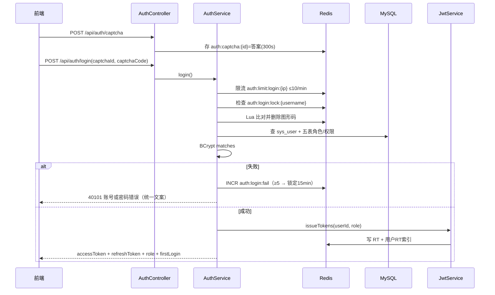
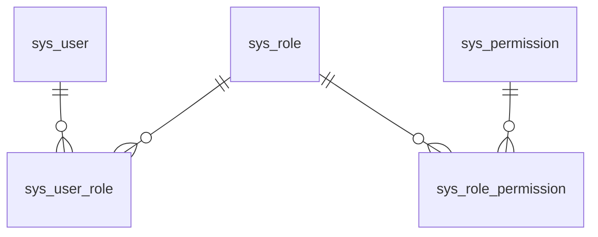
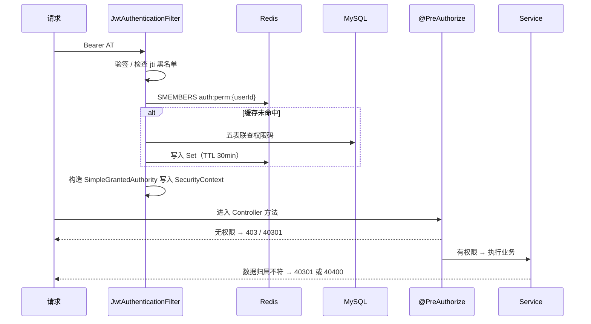

# 鉴权与授权架构文档（AIES）

> 适用代码：`backend`（Spring Boot 3.2.5 / Java 17）+ `frontend`（Vue 3 + Pinia）
> 生成日期：2026-11-24
> 事实来源：本文全部结论以当前仓库代码为准，关键结论均标注代码位置。
> 版本说明：旧版本文档（Sa-Token 单 token 方案）已与代码脱节，勘误对照见 [§7 旧文档勘误](#7-旧文档勘误)。

## 1. 结论速览

| 关注点 | 结论 |
|---|---|
| 认证框架 | Spring Security 6（`spring-boot-starter-security`） |
| 令牌方案 | 自签 JWT（jjwt 0.12.5，HS512）作为 AT + Redis 随机串作为 RT |
| 会话模式 | 无状态，`SessionCreationPolicy.STATELESS`，服务端不建 HttpSession |
| 授权框架 | Spring Security 方法级 `@PreAuthorize` + 五表 RBAC 权限码 |
| 权限数据 | MySQL `sys_user / sys_role / sys_user_role / sys_role_permission / sys_permission` |
| 权限缓存 | Redis Set `auth:perm:{userId}`，TTL 30 分钟，变更时删除键 |
| Sa-Token | 仅实验性依赖，`sa-token.experiment.enabled=false` 时不装配、不参与鉴权 |
| 前端 | Axios 注入 Bearer + 路由守卫做角色门控，仅体验层，不作为安全边界 |

```mermaid
flowchart LR
    B[浏览器 Vue3] -->|Authorization: Bearer AT| F[JwtAuthenticationFilter]
    F -->|验签/黑名单/装载权限| SC[SecurityContext]
    SC --> P[@PreAuthorize 方法级鉴权]
    P --> C[Controller / Service 数据级校验]
    F <-->|权限缓存 auth:perm| R[(Redis)]
    C --> M[(MySQL 五表RBAC)]
    A[AuthService] -->|签发 AT+RT| B
    A --> R
```

## 2. 技术选型与依赖

| 组件 | 版本/来源 | 用途 | 代码位置 |
|---|---|---|---|
| Spring Security | Boot 3.2.5 管理版本 | 过滤器链、方法级鉴权、401/403 处理 | `backend/pom.xml`、`config/SecurityConfig.java` |
| jjwt | 0.12.5（api/impl/jackson） | AT 签发与验签 | `backend/pom.xml`、`security/JwtService.java` |
| spring-security-crypto | Boot 管理版本 | BCrypt 慢哈希（strength=10） | `config/PasswordConfig.java` |
| Spring Data Redis | Boot 管理版本 | 验证码、限流、权限缓存、RT、AT 黑名单 | 各 Service |
| Hutool | 5.8.36 | 图形验证码生成 | `service/CaptchaService.java` |
| Spring Mail | Boot 管理版本 | 邮箱验证码 SMTP 通道 | `service/EmailCodeService.java` |
| Spring WebSocket | Boot 管理版本 | 评价状态实时推送 | `realtime/` |
| Sa-Token | 1.39.0（实验） | 学习对比，默认关闭 | `config/SaTokenConfigure.java`、`security/StpInterfaceImpl.java` |

> 依赖注释已明确：Sa-Token 仅为试写代码保留，运行期认证由 Spring Security 承担（`backend/pom.xml` 第 102-108 行）。

## 3. 认证（Authentication）

### 3.1 过滤器链

`config/SecurityConfig.java`：

- `@EnableWebSecurity` + `@EnableMethodSecurity`
- 关闭 CSRF，开启 CORS，会话策略 `STATELESS`
- 公开面 `PUBLIC_PATHS` 之外一律 `authenticated()`
- 未认证 → HTTP 401 + `code=40101`；越权 → HTTP 403 + `code=40301`
- `JwtAuthenticationFilter` 注册在 `UsernamePasswordAuthenticationFilter` 之前

### 3.2 公开接口白名单

| 路径 | 说明 |
|---|---|
| `/api/auth/captcha` | 图形验证码 |
| `/api/auth/login` | 账号密码登录 |
| `/api/auth/login/email` | 邮箱验证码登录 |
| `/api/auth/refresh` | RT 刷新 |
| `/api/auth/email-code` | 发送邮箱验证码 |
| `/api/auth/register` | 注册 |
| `/api/auth/password/**` | 忘记密码 / 重置密码 |
| `/api/health`、`/actuator/health` | 健康探针 |
| `/ws/**` | WebSocket 握手，由 Handler 内自行校验 JWT |

> 注意：`/api/files`、`/api/download/**` **不在**白名单内，必须登录后访问（旧文档称其“匿名”是错误描述）。

### 3.3 Token 模型

| 项 | AT（Access Token） | RT（Refresh Token） |
|---|---|---|
| 形态 | JWT，HS512 签名 | 32 字节随机数转 64 位十六进制串 |
| 载体 | `Authorization: Bearer <AT>` | 请求体 `refreshToken` |
| 有效期 | 默认 120 分钟（`jwt.access-token-minutes`） | 默认 7 天（`jwt.refresh-token-days`） |
| Claims | `sub=userId`、`role=主角色`、`jti`、`iat`、`exp` | 无（不透明串） |
| 服务端状态 | 登出后按 `jti` 入 Redis 黑名单 | Redis 存储并支持旋转/批量作废 |

AT **不携带权限清单**。权限码在每次请求时由过滤器装载，因此权限矩阵调整后无需重新登录，缓存键删除后的下一次请求即按新权限判定（角色 claim 的滞后见 §4.6）。

Redis 键规范：

| Key | 类型/TTL | 含义 |
|---|---|---|
| `auth:at:bl:{jti}` | String，剩余有效期 | AT 登出黑名单 |
| `auth:rt:token:{rt}` | String，7 天 | RT → userId |
| `auth:rt:user:{userId}` | Set，7 天 | 用户全部 RT 索引（改密/禁用时批量作废） |
| `auth:perm:{userId}` | Set，30 分钟 | 用户权限码缓存 |
| `auth:login:fail:{username}` | String，15 分钟 | 登录失败计数 |
| `auth:login:lock:{username}` | String，15 分钟 | 登录锁定标记 |
| `auth:limit:login:{ip}` | String，60 秒 | 登录限流 10 次/分钟 |
| `auth:limit:captcha:{ip}` | String，60 秒 | 图形码限流 20 次/分钟 |
| `auth:limit:emailcode:{ip}` | String，60 秒 | 发码限流 5 次/分钟 |
| `auth:limit:register:{ip}` | String，60 秒 | 注册限流 10 次/分钟 |
| `auth:captcha:{captchaId}` | String，300 秒 | 图形验证码答案（Lua 比对即删） |
| `auth:emailcode:{username}:{scene}` | String，300 秒 | 邮箱验证码 |
| `auth:emailcode:attempts:{username}:{scene}` | String，300 秒 | 邮箱验证码错误次数 |
| `email:send:{email}` | String，60 秒 | 单邮箱发送冷却 |
| `email:hour:{email}` | String，1 小时 | 单邮箱每小时发送上限（5 次） |

### 3.4 账号密码登录时序



关键实现：

- 账号不存在与密码错误使用同一文案 `AUTH_FAIL_MSG`，防账号枚举（`AuthService.java`）。
- 连续失败 5 次锁定 15 分钟，锁定期间返回 `40103`。
- 密码使用 `BCryptPasswordEncoder(10)` 校验；数据库仅存密文（`sys_user.password`）。
- 登录/注册/发码接口均按 IP 限流，超限统一 `30010`，HTTP 429。

### 3.5 邮箱验证码三场景

| 场景 `scene` | 用途 | 命中条件 |
|---|---|---|
| `LOGIN` | 邮箱验证码登录 | 用户名存在且邮箱匹配 |
| `REGISTER` | 注册前验证邮箱 | 用户名未被占用 |
| `RESET_PASSWORD` | 找回/重置密码 | 用户名存在且邮箱匹配 |

- 6 位数字，300 秒有效，校验通过即删除（一次性）。
- 连错 5 次直接作废验证码，需重新发送。
- 单邮箱 60 秒冷却 + 每小时 5 次上限。
- 未配置 `SMTP_HOST` 时进入模拟发送（验证码打日志，`mockCode` 仅在模拟模式回显）；SMTP 投递失败返回 `40004`。
- 发送阶段对“用户名不存在/邮箱不匹配”统一返回成功但不发送，防枚举。

### 3.6 刷新、登出、改密

| 操作 | 行为 | 代码 |
|---|---|---|
| 刷新 `POST /api/auth/refresh` | 验旧 RT → 删除旧 RT → 签发新 AT+RT（旋转，防重放） | `JwtService.rotateRefreshToken` |
| 登出 `POST /api/auth/logout` | AT 的 `jti` 写入黑名单，TTL=剩余有效期；返回 204 | `AuthService.logout` |
| 重置密码 `POST /api/auth/password/reset` | 更新 BCrypt 密文后作废该用户全部 RT | `AuthService.resetPassword` |
| 管理员禁用用户 | 作废全部 RT + 删除权限缓存；AT 依赖自然过期（≤2h） | `AdminUserService.updateStatus` |

> 前端当前**未实现** AT 过期自动静默续期：响应拦截器遇到 `40101` 会清理登录态并跳转登录页。RT 刷新接口已就绪，供后续需要时接入。

### 3.7 WebSocket 认证

- 接入点：`/ws?token=<AT>`（`realtime/WebSocketConfig.java`）。
- 浏览器 WebSocket 无法设置 `Authorization` 头，因此握手时由 `RealtimeWebSocketHandler` 解析 query 中的 token。
- 校验内容：JWT 验签 → 黑名单 → 用户存在且 `status=1`；失败以 1008 关闭连接。
- `/ws/**` 在 `SecurityConfig` 中放行，实际鉴权在 Handler 内完成。

### 3.8 已落地的安全控制

| 编号 | 控制点 | 实现位置 |
|---|---|---|
| S-01 | BCrypt 慢哈希（strength=10） | `config/PasswordConfig.java` |
| S-02 | 登录失败统一文案，防账号枚举 | `AuthService.AUTH_FAIL_MSG` |
| S-03 | IP 维度 Redis 限流 | `common/RateLimiter.java`、`CaptchaService` |
| S-04 | 连续失败锁定 | `AuthService.recordLoginFailure` |
| S-05 | 数据归属/可见性校验 | `TaskService`、`SubmissionService`、`EvaluationQueryService` |
| S-06 | 写接口标注权限点 | 各 Controller `@PreAuthorize` |
| S-07 | 文件安全：扩展名+MIME 双白名单、UUID 重命名、key 防穿越 | `SubmissionService`、`FileStorage` |
| S-09 | 管理端写操作审计留痕 | `AdminAuditService` |
| S-10 | AT 黑名单、RT 旋转、改密作废全部 RT | `JwtService` |
| S-11 | 验证码一次性消费 | `CaptchaService`、`EmailCodeService` |
| S-12 | 邮箱发送频控 | `EmailCodeService` |
| S-13 | 找回密码防枚举 | `AuthService.forgotPassword` |
| S-14 | JWT 密钥零明文、≥64 字节启动校验 | `JwtService.init` |

### 3.9 认证接口清单

| 接口 | 鉴权要求 |
|---|---|
| `GET /api/auth/captcha` | 匿名 |
| `POST /api/auth/login` | 匿名 |
| `POST /api/auth/login/email` | 匿名 |
| `POST /api/auth/email-code` | 匿名 |
| `POST /api/auth/register` | 匿名 |
| `POST /api/auth/password/forgot` | 匿名 |
| `POST /api/auth/password/reset` | 匿名 |
| `POST /api/auth/refresh` | 匿名（凭 RT） |
| `POST /api/auth/logout` | 登录 + `auth:logout` |
| `GET /api/auth/me` | 登录 + `user:me` |

登录/刷新响应体（`dto/LoginResponse.java`）：

```json
{
  "accessToken": "<JWT>",
  "refreshToken": "<64位十六进制串>",
  "role": "STUDENT",
  "firstLogin": false
}
```

用户详情经 `GET /api/auth/me` 返回，包含 `roles` 与 `permissions` 清单（`dto/UserVO.java`）。

## 4. 授权（Authorization）

### 4.1 五表 RBAC 模型



| 表 | 作用 |
|---|---|
| `sys_user` | 用户主表（含 `status` 启用/禁用、`first_login`） |
| `sys_role` | 内置角色 STUDENT / TEACHER / ADMIN（`built_in=1`） |
| `sys_user_role` | 用户-角色关联（应用层约束默认单角色） |
| `sys_permission` | 权限点（`perm_code` 唯一） |
| `sys_role_permission` | 角色-权限关联 |

建表与种子数据唯一事实源为 Flyway 单文件基线：`backend/src/main/resources/db/migration/V1__baseline.sql`（2026-11-24 由原 V1-V20 压缩，当前库 `flyway_schema_history` 仅保留 V1）。

### 4.2 权限点与角色矩阵

基线共 26 个权限点（原 V1 的 22 个 + V14 报表 3 个 + V20 聊天 1 个）：

| 模块 | 权限点 |
|---|---|
| auth | `auth:logout` |
| user | `user:me`、`user:manage` |
| task | `task:create`、`task:publish`、`task:edit`、`task:view` |
| submission | `submission:upload`、`submission:view` |
| evaluation | `evaluation:view`、`evaluation:review`、`evaluation:re-evaluate`、`evaluation:history:view` |
| report | `report:view`、`report:export` |
| system | `role:manage`、`system:config`、`class:manage`、`audit:view`、`llm:config`、`prompt:manage`、`golden:manage` |

V14 追加报表域 3 个权限点：`report:view:teacher`、`report:view:student`、`report:refresh`。

角色分配：

| 角色 | 权限规模 | 说明 |
|---|---|---|
| ADMIN | 22 | V1 全量；V14 新增的 3 个报表权限**未授予** ADMIN |
| TEACHER | 14 + 2 | 任务/评价/报表/班级链路；V14 增加 `report:view:teacher`、`report:refresh` |
| STUDENT | 7 + 1 | 任务查看/提交/评价查看/本人报表；V14 增加 `report:view:student` |

权限点常量的唯一代码来源：`backend/src/main/java/com/aies/common/PermissionConstants.java`（禁止在 Controller 中写裸字符串，`UploadController` 目前仍为字面量，属轻微不一致）。

### 4.3 运行时鉴权链路



要点：

1. 过滤器只负责“认证 + 装载权限”，不做接口级判断。
2. 权限码即 `GrantedAuthority`，`@PreAuthorize("hasAuthority('...')")` 直接比对。
3. 方法级拦截抛出的 `AccessDeniedException` 由 `exception/ApiExceptionHandler.java` 统一转 403/40301。
4. 数据级归属校验在 Service 内完成，返回 40301 或 40400（IDOR 同形化）。

### 4.4 接口权限矩阵

| 控制器 | 接口 | 权限要求 |
|---|---|---|
| `AuthController` | `POST /api/auth/logout` | `auth:logout` |
| `AuthController` | `GET /api/auth/me` | `user:me` |
| `TaskController` | `POST /api/tasks` | `task:create` |
| `TaskController` | `PUT/DELETE /api/tasks/{id}` | `task:edit` |
| `TaskController` | `POST /api/tasks/{id}/publish` | `task:publish` |
| `TaskController` | `GET /api/tasks`、`GET /api/tasks/{id}` | `task:view` |
| `SubmissionController` | `POST /api/submissions`、`POST /{id}/cancel` | `submission:upload` |
| `SubmissionController` | `GET /mine`、`GET /{id}`、`GET /{id}/download`、`GET /{id}/download/stream` | `submission:view` |
| `EvaluationController` | `GET /api/evaluations/{id}` | `evaluation:view` |
| `EvaluationController` | `PUT /{id}/review`、`PUT /{id}/manual` | `evaluation:review` |
| `EvaluationController` | `POST /{id}/re-evaluate` | `evaluation:re-evaluate` |
| `EvaluationController` | `GET /{id}/history`、`GET /{id}/history/{versionNo}` | `evaluation:history:view` |
| `EvaluationController` | `POST /{id}/appeal` | `submission:upload`（学生申诉） |
| `TeacherWorkflowController` | `GET /api/teacher/workflow/submissions` | `submission:view` |
| `TeacherWorkflowController` | `POST /submissions/{id}/ai-evaluate` | `task:edit` |
| `TeacherWorkflowController` | `POST /evaluations/{id}/approve` | `evaluation:review` |
| `ReportController` | `GET /api/reports/overview` | `report:view:teacher` |
| `ReportController` | `GET /api/reports/overview/me` | `report:view:student` |
| `ReportController` | `POST /api/reports/refresh` | `report:refresh` |
| `ProfileController` | `PUT /api/profile` | `user:me` |
| `UploadController` | `/api/upload/**` | `submission:upload` |
| `AdminController` | `/api/admin/users/**` | `user:manage` |
| `AdminController` | `/api/admin/teachers` | `user:manage` 或 `class:manage` |
| `AdminController` | `/api/admin/evaluations` | `evaluation:view` |
| `AdminController` | `/api/admin/roles`、`/permissions`、`PUT /roles/{id}/permissions` | `role:manage` |
| `AdminController` | `/api/admin/classes/**` | `class:manage` |
| `AdminController` | `/api/admin/audit-logs` | `audit:view` |
| `AdminController` | `/api/admin/system/config`、`/api/admin/mq/**` | `system:config` |
| `AdminController` | `/api/admin/llm-configs/**` | `llm:config` |
| `AdminController` | `/api/admin/prompts/**` | `prompt:manage` |
| `AdminController` | `/api/admin/golden-samples/**` | `golden:manage` |
| `FileController` | `GET/DELETE /api/files/**` | 仅登录；Service 内校验 `ADMIN` |
| `DownloadController` | `GET /api/download/**` | 仅登录（无权限点，见 §8） |

### 4.5 数据级授权

注解只能回答“有没有这个权限点”，不能回答“能不能操作这条数据”。关键服务内做了二次校验：

| 场景 | 校验规则 | 代码 |
|---|---|---|
| 教师创建任务 | 目标班级的 `teacher_id` 必须等于当前用户，否则 40301 | `TaskService.create` |
| 学生提交作业 | 必须为 STUDENT，任务对该生可见，否则 40400 | `SubmissionService.submit` |
| 查看/取消/下载提交 | 提交记录的 `student_id` 必须等于当前用户，否则 40400 | `SubmissionService.requireOwned` |
| 查看评价 | 学生仅本人；教师仅任教任务或本人被指派申诉的提交 | `EvaluationQueryService.requireReadable` |
| 文件中心 | 仅 ADMIN 可查看/删除 | `FileCenterService.requireAdmin` |
| 报表范围 | 教师 `/overview` 仅任教任务聚合；学生仅 `/overview/me` | `ReportController` + `ReportQueryService` |

### 4.6 权限变更如何生效

| 操作 | 生效方式 | 代码 |
|---|---|---|
| 修改角色权限矩阵 | 重建 `sys_role_permission`，删除该角色全部用户的 `auth:perm:{id}` | `AdminRbacService.updateRolePermissions` |
| 调整用户角色 | 重建 `sys_user_role`，删除该用户 `auth:perm:{id}` | `AdminUserService.updateRoles` |
| 禁用用户 | 删除权限缓存 + 作废全部 RT；AT 在 2h 内仍可通过验签 | `AdminUserService.updateStatus` |
| 权限缓存兜底 | 未命中回源数据库，TTL 30 分钟自然过期 | `JwtAuthenticationFilter.loadPermissions` |

> 由于 AT 的 `role` claim 在签发时固定，角色调整后“权限码”立即生效，但依赖 `principal.role()` 的判断（如 `FileCenterService.requireAdmin`、报表 scope）最迟在 AT 过期/刷新后更新。

### 4.7 前端侧实现（体验层）

| 能力 | 实现 |
|---|---|
| Token 存储 | `sessionStorage`：`aies_at` / `aies_rt`，每标签页独立会话（`utils/authSession.ts`） |
| 跨窗口交接 | `BroadcastChannel` + 一次性 nonce，避免把 token 写入 URL（`utils/authSession.ts`、`main.ts`） |
| 请求注入 | Axios 请求拦截器添加 `Authorization: Bearer <AT>`（`api/request.ts`） |
| 统一错误处理 | `40101` 清态回登录页；`40301` 提示无权限（`api/request.ts`） |
| 下载 | `fetchBlob` 手动携带 AT（`api/request.ts`） |
| 路由守卫 | 未登录跳 `/login`；载入 `/me`；`meta.roles` 不匹配跳 `/403`（`router/index.ts`） |
| 菜单门控 | 按主角色选择模块组（`views/ModulesView.vue`） |
| 权限展示 | 管理端角色权限矩阵、权限点中文映射（`constants/permissions.ts`） |

> 前端门控只改善体验，真正的安全边界始终在后端：任何前端判断都可通过直接调用 API 绕过。

## 5. 错误码与 HTTP 映射

| code | 含义 | HTTP |
|---|---|---|
| 0 | 成功 | 200/204 |
| 30000 | 参数校验失败 | 400 |
| 30008 | 图形验证码错误或过期 | 200 |
| 30009 | 邮箱验证码错误或过期 | 200 |
| 30010 | 操作过于频繁 | 429 |
| 30013 | 密码强度不足 | 200 |
| 30014 | 邮箱未绑定 | 200 |
| 40004 | 邮件服务不可用 | 200 |
| 40101 | 未登录/令牌无效/登录失败 | 401 |
| 40103 | 账号禁用或锁定 | 401 |
| 40301 | 无操作权限 | 403 |
| 40400 | 资源不存在 | 404 |
| 50000 | 系统异常 | 500 |

映射实现：`exception/ApiExceptionHandler.java`（`statusOf` 方法）。

## 6. 配置说明

| 配置项 | 默认值 | 说明 |
|---|---|---|
| `JWT_SECRET`（env） | 无 | HS512 密钥，必须 ≥64 字节；缺失/过短启动失败 |
| `jwt.access-token-minutes` | 120 | AT 有效期 |
| `jwt.refresh-token-days` | 7 | RT 有效期 |
| `sa-token.experiment.enabled` | false | 置 true 才装配 Sa-Token 拦截器与 `StpInterfaceImpl` |
| `auth.captcha.*` | 300s / 120×40 / 4位 | 图形验证码 |
| `auth.email.*` | 300s / 60s / 5次/h / 5次错误 | 邮箱验证码 |
| `SMTP_HOST` 等 | 空 | 未配置时模拟发送；失败返回 40004 |

启动校验：`JwtService.init()` 在 `@PostConstruct` 中断言密钥长度，防止无签名密钥运行。

## 7. 旧文档勘误

旧版《认证授权接口文档》面向 Sa-Token 脚手架，以下描述已与当前代码不符：

| 旧文档描述 | 当前事实 | 依据 |
|---|---|---|
| 认证框架为 Sa-Token，配置 `sa-token.token-name` 等 | Spring Security 6 + 自签 JWT；Sa-Token 默认关闭 | `pom.xml`、`application.yml`、`SecurityConfig` |
| 单 `token` 字段，有效期 30 天 | `accessToken`（2h）+ `refreshToken`（7d）双令牌 | `LoginResponse.java`、`JwtService` |
| 后端包名 `com.group11.aievaluate` | `com.aies` | 源码目录 |
| 建表脚本 `backend/sql/schema.sql` | Flyway `db/migration/V1__baseline.sql` 为唯一事实源 | `application.yml`、迁移目录 |
| 验证码通道为短信（`/api/auth/sms/*`） | 唯一通道为邮箱（`/api/auth/email-code`、`/api/auth/login/email`），短信代码已删除 | `AuthService`、`AuthController` |
| 上传接口使用 Sa-Token 权限 `file:upload` / `file:manage` | 使用 Spring Security 权限点 `submission:upload`；无 `file:*` 权限点 | `UploadController`、`V1__baseline.sql` |
| student 调用 `corrupt-chunk` 返回 403，权限 `file:manage` | 所有上传接口统一 `submission:upload`，学生拥有该权限 | `UploadController`、`PermissionConstants` |
| `/api/files`、`/api/download/**` 匿名访问 | 均需登录；`/api/files` 仅 ADMIN | `SecurityConfig`、`FileCenterService` |
| 错误码 40001=用户名或密码错误、40100=未登录、40300=无权限 | 实际为 40101（登录失败/未登录）、40301（无权限） | `ErrorCode.java` |
| 权限校验使用 `@SaCheckLogin` / `@SaCheckPermission` | 全仓库无 Sa-Token 注解，使用 `@PreAuthorize` | Controller 扫描结果 |
| 注册请求含 `phone`、`nickname`、`confirmPassword` | 注册使用 `username/password/realName/email/classCode/emailCode/captcha*` | `RegisterRequest`、`RegisterView` |
| 图形验证码字段为 `captchaKey` | 实际字段为 `captchaId` | `dto/CaptchaResponse.java` |
| 密码长度 6-32 位 | 注册/重置要求 8-32 位且同时含字母与数字，否则 30013 | `AuthService.PASSWORD_STRONG`、`RegisterRequest` |

## 8. 已知限制与风险

1. **下载接口缺少权限点**：`DownloadController` 仅要求登录，任何已登录用户可按文件 ID 下载；建议补充权限点或归属校验（与 `SubmissionController` 的下载路径对齐）。
2. **禁用用户 AT 不立即失效**：过滤器只校验签名与黑名单，不查 `status`；禁用后最长 2 小时内旧 AT 仍可调用接口（WebSocket 握手会校验状态）。可通过缩短 AT 或增加状态校验缓解。
3. **角色 claim 滞后**：依赖 `principal.role()` 的逻辑在角色调整后需等 AT 过期/刷新才更新；权限码本身已即时生效。
4. **登录失败计数不清零**：登录成功后未删除 `auth:login:fail:{username}`，15 分钟内累计失败仍可能触发锁定（当前实现行为，非漏洞）。
5. **Sa-Token 实验代码**：`SaTokenConfigure` / `StpInterfaceImpl` 仅在开关打开时装配，且业务接口未使用 Sa-Token 注解，开启后不会改变鉴权结果。
6. **报表权限未覆盖 ADMIN**：V14 的三个报表权限点只授予 TEACHER/STUDENT，管理员全局报表尚未开放（与设计注释“M3+ 候选”一致）。
7. **前端不自动续期**：AT 过期直接回登录页；RT 旋转接口已实现但未接入 Axios 拦截器。

## 9. 验证与测试

相关自动化测试：

| 测试 | 覆盖点 |
|---|---|
| `security/JwtServiceTest` | AT 签发/验签、黑名单、RT 旋转 |
| `security/JwtAuthenticationFilterTest` | Bearer 解析、权限装载、匿名放行 |
| `service/AuthServiceTest` | 登录、注册、锁定、防枚举 |
| `controller/AuthControllerTest` | 认证接口契约与状态码 |
| `common/RateLimiterTest` | Redis 限流窗口 |
| `ArchUnitTest` | 分层与依赖约束 |

本地联调建议：

```bash
# 1. 获取图形验证码（匿名）
curl -s http://localhost:8080/api/auth/captcha

# 2. 从 Redis 取答案（仅本地调试）
redis-cli GET "auth:captcha:<captchaId>"

# 3. 登录
curl -s -X POST http://localhost:8080/api/auth/login \
  -H "Content-Type: application/json" \
  -d '{"username":"student","password":"Passw0rd","captchaId":"<id>","captchaCode":"<code>"}'

# 4. 携带 AT 访问受保护接口
curl -s http://localhost:8080/api/auth/me -H "Authorization: Bearer <accessToken>"

# 5. 断言权限缓存
redis-cli SMEMBERS "auth:perm:3"
```

演示账号（dev 库当前密码，`first_login=0`）：`admin / Passw0rd`、`teacher / Passw0rd`、`student / Passw0rd`。该密码对应 `docs/02-00-decision-log.md` D-27（dev 种子密码 `Passw0rd`）；当前 `V1__baseline.sql` 中的数据即 `Passw0rd` 哈希，原 `V1__rbac.sql` 注释里的 `Admin@123 / Teacher@123 / Student@123` 已随 2026-11-24 迁移压缩移除，不能用于当前环境。生产环境务必删除演示账号或改密。
